# Architecture Overview

This document provides a contributor-oriented overview of `InterChangableTrade-Core`: module layout, request lifecycle, transaction boundaries, domain events, and the Stellar/Soroban integration boundary.

> **Note:** This is a codebase overview, not a guarantee that every described capability is fully production-complete. See [Implementation Status](status.md) for known stubs and partial implementations.

## Module map

Modules registered in `src/app.module.ts` (Nest application composition):

- `analytics`
- `assets`
- `audit`
- `auth`
- `authorization`
- `blockchain-indexer`
- `compliance`
- `dispute-resolution`
- `error-handler`
- `escrow`
- `liquidity-aggregator`
- `marketplace`
- `notifications`
- `portfolio`
- `queue`
- `rate-limiting`
- `resilience`
- `risk-management`
- `stellar`
- `trading`
- `trading-engine`
- `transaction-coordinator`
- `transactions`
- `users`
- `wallet`
- `webhooks`

Infrastructure/config modules also bootstrapped at app level: `ConfigModule`, `TypeOrmModule.forRootAsync(DatabaseConfig)`, `RedisModule`, `EventEmitterModule.forRoot()`.

```mermaid
graph TD
  App[AppModule] --> Config[ConfigModule]
  App --> DB[TypeOrmModule/DatabaseConfig]
  App --> Redis[RedisModule]
  App --> Events[EventEmitterModule]

  App --> Auth[auth]
  App --> Users[users]
  App --> Stellar[stellar]
  App --> Trading[trading]
  App --> TradingEngine[trading-engine]
  App --> Marketplace[marketplace]
  App --> Tx[transactions]
  App --> Escrow[escrow]
  App --> Disputes[dispute-resolution]
  App --> Compliance[compliance]
  App --> Analytics[analytics]
  App --> Indexer[blockchain-indexer]
  App --> Webhooks[webhooks]
  App --> Notifications[notifications]
  App --> Wallet[wallet]
  App --> Portfolio[portfolio]
  App --> Liquidity[liquidity-aggregator]
  App --> Coordinator[transaction-coordinator]
  App --> RateLimit[rate-limiting]
  App --> Audit[audit]
  App --> Queue[queue]
  App --> Risk[risk-management]
  App --> Authz[authorization]
  App --> Resilience[resilience]
  App --> ErrorHandler[error-handler]
  App --> Assets[assets]

  Escrow --> Stellar
  TradingEngine --> Stellar
  Wallet --> Stellar
  Indexer --> Stellar
  Coordinator --> Stellar
  Disputes --> Tx
```

> The diagram is a high-level composition view based on app/module wiring and domain responsibilities; consult individual module imports for exact dependency edges.

## Request lifecycle (global chain)

Configured in `src/main.ts`:

1. **Express/Nest bootstrap** (`NestFactory.create`) and trusted proxy setting (`http.trustProxyHops`).
2. **Security middleware**: `helmet()` applied globally.
3. **Global prefix**: `app.setGlobalPrefix('api')`.
4. **Global validation pipe**: `ValidationPipe({ whitelist: true, forbidNonWhitelisted: true, transform: true })`.
5. **Global guard(s)**: `RateLimitGuard` registered via `app.useGlobalGuards(...)` (all routes unless explicitly bypassed by module/decorator conventions).
6. **Global interceptor**: `TransformInterceptor` from `@app/common` (consistent success envelope).
7. **Global exception filter**: `AllExceptionsFilter` from `@app/common`, wired with `ErrorHandlerService`.
8. **CORS**: origin allowlist from `cors.allowedOrigins` config, credentials/methods/headers configured explicitly.
9. **OpenAPI/Swagger**: document built and served at `/api/docs`.

Controller/method guards (e.g. `JwtAuthGuard`, `RolesGuard`) run as part of Nest's guard phase for decorated routes in addition to global guards.

## Transaction boundaries

- Shared transaction utilities/decorators live in `libs/common` (e.g. `@Transactional()` and `TransactionInterceptor`) and are intended for request-scoped or service-scoped database transaction boundaries where applied.
- Not all modules use the same transaction pattern; some operations rely on repository/service-level transactions or explicit `DataSource` transaction blocks (e.g. escrow flows). When modifying stateful workflows, verify the actual boundary in the module rather than assuming global transactional wrapping.
- Cross-system atomicity is **not** guaranteed where on-chain and database writes are coordinated without a distributed transaction protocol (see transaction coordinator and escrow status notes).

## Event catalogue

`EventEmitterModule.forRoot()` is enabled globally in `AppModule`. The table below lists declared domain event constants/classes and known consumers/emitters based on current source conventions. Treat this as a living reference and verify before relying on an event contract.

| Event name / constant | Declared in | Known emitters | Known consumers | Notes |
| --- | --- | --- | --- | --- |
| `notification.send` (`NotificationEvents.SEND_NOTIFICATION`) | `notifications/events/notification.events.ts` | (not exhaustively verified) | `notifications/listeners/notification.listener.ts` (`@OnEvent`) | Internal notification dispatch |
| `notification.batch` (`NotificationEvents.SEND_BATCH`) | `notifications/events/notification.events.ts` | (not exhaustively verified) | (not verified) | May be unused depending on call sites |
| `notification.schedule` (`NotificationEvents.SCHEDULE_NOTIFICATION`) | `notifications/events/notification.events.ts` | (not exhaustively verified) | (not verified) | May be unused depending on call sites |
| `notification.trigger.order_update` (`OrderUpdateEvent.NAME`) | `notifications/events/notification.events.ts` | (not exhaustively verified) | `notifications/listeners/notification.listener.ts` | Trigger event class payload |
| `notification.trigger.price_alert` (`PriceAlertEvent.NAME`) | `notifications/events/notification.events.ts` | (not exhaustively verified) | `notifications/listeners/notification.listener.ts` | Trigger event class payload |
| `notification.trigger.portfolio_alert` (`PortfolioAlertEvent.NAME`) | `notifications/events/notification.events.ts` | (not exhaustively verified) | `notifications/listeners/notification.listener.ts` | Trigger event class payload |
| `notification.trigger.system_notice` (`SystemNoticeEvent.NAME`) | `notifications/events/notification.events.ts` | (not exhaustively verified) | `notifications/listeners/notification.listener.ts` | Trigger event class payload |
| `dispute.created` (`DisputeEvents.DISPUTE_CREATED`) | `dispute-resolution/events/dispute.events.ts` | (not exhaustively verified) | `dispute-resolution/listeners/dispute-notification.listener.ts`, webhook listener string handlers (where mapped) |  |
| `dispute.resolved` (`DisputeEvents.DISPUTE_RESOLVED`) | `dispute-resolution/events/dispute.events.ts` | (not exhaustively verified) | `dispute-resolution/listeners/dispute-notification.listener.ts` |  |
| `dispute.appealed` (`DisputeEvents.DISPUTE_APPEALED`) | `dispute-resolution/events/dispute.events.ts` | (not exhaustively verified) | (not verified) | Possibly unconsumed/dead; verify before use |
| `dispute.arbitrator_assigned` (`DisputeEvents.ARBITRATOR_ASSIGNED`) | `dispute-resolution/events/dispute.events.ts` | (not exhaustively verified) | `dispute-resolution/listeners/dispute-notification.listener.ts` |  |
| `dispute.sla_breach` (`DisputeEvents.SLA_BREACH`) | `dispute-resolution/events/dispute.events.ts` | (not exhaustively verified) | (not verified) | Possibly unconsumed/dead; verify before use |
| `escrow.created` / `funded` / `approved` / `settled` / `refunded` / `expired` / `cancelled` / `disputed` / `signature_threshold_reached` / `milestone_completed` / `partial_release` (`EscrowEvents.*`) | `escrow/events/escrow.events.ts` | `escrow.service.ts` emits event names (e.g. `EscrowEvents.*`) in workflow paths (verify per event) | `webhooks/webhook-event.listener.ts` listens for selected string events (e.g. `escrow.created`, `escrow.funded`, `escrow.disputed`; also `escrow.released`/`escrow.resolved` are listened for but constant names differ) | Some escrow events/constants may have no listeners and some webhook listeners may expect names not emitted by constants; reconcile during event refactors |
| `multisig.transaction.proposed` / `signed` / `ready` / `submitted` / `failed` (`MultisigEvents.*`) | `wallet/events/multisig.events.ts` | (not exhaustively verified) | (not verified) | Possibly emitted/consumed in wallet flows; verify call sites |
| Webhook-routed string events (examples: `trade.created`, `trade.completed`, `trade.cancelled`, `trade.failed`, `settlement.*`, `balance.*`, `escrow.released`, `escrow.resolved`, `transaction.initiated`, etc.) | `webhooks/webhook-event.listener.ts` (`@OnEvent`) | Various modules/services (not exhaustively verified) | `WebhookEventListener` dispatches to webhook subscriptions | Canonical names are defined by listener subscriptions and `WebhookEvent` enum mapping; ensure emitters use matching strings |

**Dead/unverified events:** several declared constants or listener subscriptions may be emitted by nobody or consumed by nothing in the current codebase state. Before adding behavior, search for both emitters (`eventEmitter.emit(...)`) and listeners (`@OnEvent(...)`) for the exact event name.

## Stellar boundary rule

All chain access must flow through `src/modules/stellar` services. Feature modules should not call Horizon or Soroban RPC directly; instead use the Stellar gateway and Soroban client/service abstractions so that:

- connection/client reuse and lifecycle concerns remain centralized,
- rate limiting and request queuing (gateway) are consistently applied,
- Soroban invocation/state/error handling is typed and normalized,
- configuration and network selection stay in one place.

When adding chain-related behavior, prefer extending the `stellar` module interfaces/services rather than introducing ad-hoc SDK calls elsewhere.

## Data flow (demo path: list → trade → settle → index)

This summarizes the intended end-to-end flow described by roadmap goals; individual steps may be partially implemented or simulated depending on module (see [Implementation Status](status.md)).

1. **List**: create/publish marketplace/listing or order intent through marketplace/trading APIs.
2. **Trade**: match/execute via trading/trading-engine services, producing trade/order records and domain events.
3. **Settle**: coordinate settlement/escrow or transaction flows; on-chain settlement behavior may be partial/stubbed in current implementations.
4. **Index**: blockchain-indexer ingests ledger/contract events and persists/queryable indexed state for downstream reads and analytics.

For an executable, verified testnet walkthrough and published contract IDs/hashes, track the roadmap items in [ROADMAP.md](../ROADMAP.md).

## Related docs

- [README](../README.md)
- [Implementation Status](status.md)
- [Environment Reference](environment.md)
- [ROADMAP](../ROADMAP.md)
